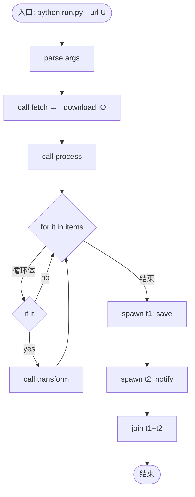
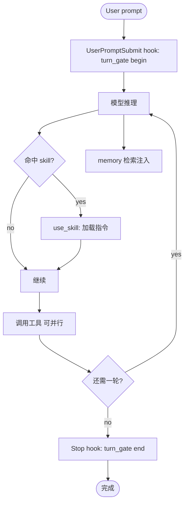

# Q4 · 具体例子：如何剖析并画出流程图（Python 代码 / Agent 项目）

## 问题
针对 `questions/001.md` 的设计，举一个**具体**例子说明：有一段 Python 代码 / 一段 Agent 项目时，怎么剖析并画出流程图（不要泛泛而谈）。

## 回答
下面用两个**真实、可对照**的例子演示「源码 → 捕获 → Workflow Graph → 流程图」全过程。

### 一、Python 代码实例
**① 源码（run.py，含调用 / 循环 / 分支 / 多线程）**
```python
import argparse, threading

def fetch(url):
    return _download(url)            # IO 调用

def transform(item):
    return item.strip().upper()      # 纯计算

def process(items):
    out = []
    for it in items:                 # 循环
        if it:                       # 分支
            out.append(transform(it))
    return out

def save(out):    write_disk(out)
def notify(out):  send_email(out)

def main():
    args = argparse.parse_args()     # 入口第一步
    data = fetch(args.url)           # 调用
    result = process(data)           # 调用(内含循环+分支)
    t1 = threading.Thread(target=save,   args=(result,))
    t2 = threading.Thread(target=notify, args=(result,))
    t1.start(); t2.start()           # 并行分叉
    t1.join(); t2.join()             # 并行汇合

if __name__ == "__main__":
    main()
```

**② 剖析步骤（对应 001 的 Mode B 代码追踪，`depth` 全开）**
1. 入口：`python run.py --url U`（kind=入口）。
2. `parse_args`：顺序（kind=处理）。
3. `call fetch` → `_download`：调用 + IO（kind=调用，meta=`run.py:4`）。
4. `call process`：进入子过程；内部 `for it` 循环 → `if it` 分支（yes→`call transform`）→ 回边到 for（kind=循环 + 分支，loop-back 边）。
5. `spawn t1(save)` / `spawn t2(notify)`：并行分叉（kind=并行分叉，parallel-member 边，meta=thread id）。
6. `join`：并行汇合（kind=汇合）。
7. 结束（kind=结束）。

**③ 节点 / 边映射（落进 001 的 Workflow Graph）**
- node.kind ∈ {入口, 处理, 调用, 分支, 循环, 并行分叉, 汇合, 结束}
- edge.type ∈ {next, call, branch(yes/no), loop-back, parallel-member, join}

**④ 画出的流程图（Mermaid，符号对标 Q2/Q3）**


### 二、Agent 项目实例（真实机制：本会话的 Agent 流）
以用户「发一条 prompt 给 CodeBuddy」为例，触发链是真实存在的（非虚构）：
1. 入口：user prompt 提交。
2. `UserPromptSubmit` hook 触发 → `turn_gate.py begin`（kind=触发，meta=hook）。
3. 模型推理；若 prompt 命中某 skill（如 `pdf`/`xlsx`），`use_skill` 触发 → 加载该 skill 指令（kind=触发，条件=文本/语义匹配）。
4. 同时 memory 检索注入（kind=触发，条件=相关记忆存在）。
5. 模型调用工具：可**并行**多个 tool call（kind=并行分叉）。
6. 判定是否还需一轮：是 → 回边到「模型推理」（agentic loop）；否 → `Stop` hook 触发 `turn_gate.py end`（kind=触发，回边 loop-back + 结束）。

**流程图（Mermaid）**


### 三、两件实例如何落进 questions/001.md 的模型
- 两者都产出**同一套 Workflow Graph**：Python 例偏 `call/循环/并行分叉`，Agent 例偏 `触发/并行/loop-back`，但 `kind` 与边 `type` 完全共用 → 渲染层（可折叠树 + Mermaid）直接复用。
- 展示时：顶层只显「入口 → 主步骤链」；展开 `process` 才见循环+分支，展开「调用工具」才见并行分支——正是 001 的 capture-max / render-on-demand。

### 需确认的点
- 这两个例子是否够「具体」作为架构文档 `architecture/001.md` 的示范章节？还是你需要换成**你自己的某个真实项目**来剖析（可提供路径，我直接用 Mode B 追踪它）。
